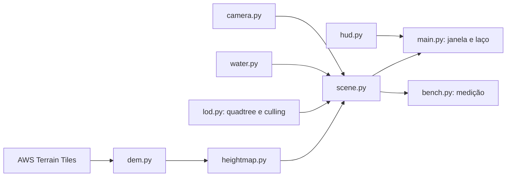

# Visualização de Elevação Costeira

Visualizador 3D em tempo real do relevo da Baixada Santista (SP), com nível de detalhe adaptativo (CDLOD) e superfície oceânica animada, para observar áreas submersas em cenários de subida do nível do mar.


[](docs/artigo_final/Visualiza%C3%A7%C3%A3o%20Interativa%20de%20Eleva%C3%A7%C3%A3o%20Costeira%20com%20N%C3%ADvel%20de%20Detalhe%20Adaptativo%20e%20Simula%C3%A7%C3%A3o%20Oce%C3%A2nica%20para%20An%C3%A1lise%20de%20Cen%C3%A1rios%20de%20Subida%20do%20N%C3%ADvel%20do%20Mar.pdf)

## Sumário

- [Sobre o projeto](#sobre-o-projeto)
- [Funcionalidades](#funcionalidades)
- [Início rápido](#início-rápido)
- [Instalação](#instalação)
- [Uso](#uso)
- [Controles](#controles)
- [Parâmetros principais](#parâmetros-principais)
- [Exemplos incluídos](#exemplos-incluídos)
- [Arquitetura](#arquitetura)
- [Tratamento de erros](#tratamento-de-erros)
- [Testes](#testes)
- [Benchmark](#benchmark)
- [Estrutura do projeto](#estrutura-do-projeto)
- [Limitações conhecidas](#limitações-conhecidas)
- [Solução de problemas](#solução-de-problemas)
- [Documentação](#documentação)
- [Referências](#referências)
- [Autores](#autores)
- [Licença](#licença)

## Sobre o projeto

Trabalho final da disciplina de Computação Gráfica (Engenharia de Computação, 10.º semestre, FHO/Uniararas), Eixo 6 (Topografia), adaptado ao cenário de erosão costeira e subida do nível do mar.

O projeto trata dos seguintes problemas:

1. **Custo de renderizar terreno extenso.** Uma malha uniforme de alta resolução tem milhões de triângulos. O projeto implementa CDLOD (*Continuous Distance-Dependent Level of Detail*), que usa uma quadtree e seleciona o detalhe de cada bloco pela distância da câmera.
2. **Descontinuidades entre níveis de detalhe.** O *geomorphing* no *vertex shader* evita fendas (*cracks*) entre blocos de resoluções diferentes.
3. **Representação do mar.** Seis ondas de Gerstner, com iluminação de Blinn-Phong e termo de Fresnel, formam uma superfície de nível ajustável.
4. **Medição do ganho.** Um *benchmark* sem janela compara a malha completa, o CDLOD, o CDLOD sem *morphing* e o CDLOD com *frustum culling*, em tempo de quadro e memória.

## Funcionalidades

- Terreno real (DEM da Baixada Santista, AWS Terrain Tiles) ou procedural (ruído Simplex).
- CDLOD com quadtree de 5 níveis, blocos de 32×32 subdivisões e *geomorphing*.
- *Frustum culling* vetorizado, sem alteração da imagem.
- Água com 6 ondas de Gerstner e nível ajustável (cenários 0 / +0,5 / +1 / +2 m).
- Interface de apoio: tela de boas-vindas, legenda em dois níveis, painel de status, bússola e minimapa.
- *Benchmark* de tempo de quadro e memória, com gráficos e resumo estatístico.

## Início rápido

Requer Python 3.11 ou superior e GPU compatível com OpenGL 3.3.

```bash
git clone https://github.com/Scaglia05/ComputacaoGrafica_BaixadaSantista.git
cd ComputacaoGrafica_BaixadaSantista
pip install -r requirements.txt
python src/main.py
```

Na primeira execução, `src/dem.py` baixa os tiles do DEM (20 arquivos PNG, cerca de 1 MB) e os guarda em `src/data/tiles/`. É necessário acesso à internet nessa etapa.

## Instalação

| Requisito | Versão | Finalidade |
|---|---|---|
| Python | 3.11 ou 3.12 | Linguagem. Em 3.13, algumas bibliotecas tentam compilar do código-fonte e falham sem o Visual C++ Build Tools |
| moderngl | 5.11 ou superior | API OpenGL |
| glfw | 2.7 ou superior | Janela, teclado e mouse |
| PyGLM | 2.7 ou superior | Vetores e matrizes |
| numpy | 1.26 ou superior | Operações vetorizadas |
| Pillow | 10.4 ou superior | Leitura de imagens |
| opensimplex | 0.4.5 ou superior | Terreno procedural |
| matplotlib | 3.8 ou superior | Gráficos do benchmark |
| psutil | 5.9 ou superior | Medição de RAM |
| `nvidia-smi` | opcional | VRAM e uso de GPU no benchmark (apenas GPUs NVIDIA) |

Criação do ambiente virtual:

```bash
py -3.11 -m venv .venv
```

Ativação:

```bash
# Windows (PowerShell)
.venv\Scripts\Activate.ps1

# Linux ou macOS
source .venv/bin/activate
```

Instalação das dependências:

```bash
pip install -r requirements.txt
```

## Uso

### Aplicação interativa

```bash
python src/main.py
```

A fonte do terreno é definida pela constante `FONTE_TERRENO` em `src/main.py`: `"dem"` (padrão, DEM real) ou `"procedural"` (ruído). Com o DEM, os cenários de nível do mar são expressos em metros reais. Os controles estão na seção [Controles](#controles).

### Área emersa alagada por cenário

```bash
python src/area_alagada.py
```

O script calcula, sobre o DEM, a área emersa (elevação maior ou igual a 0 m) abaixo de cada nível. Resultado obtido em execução de verificação:

```
área emersa (elev >= 0 m): 1927 km²
células com elev ~ 0 m (< 1 mm): 104.6 km²

nível   alagada(km²)  % da emersa  sem células a 0 m(km²)
+ 0.5 m        119.4         6.2%                  14.8
+ 1.0 m        127.7         6.6%                  23.1
+ 2.0 m        143.5         7.4%                  38.9
+10.0 m        505.0        26.2%                 400.4
```

### Demais scripts

| Comando | Finalidade | Pré-requisito |
|---|---|---|
| `python exemplos/janela.py` | Janela vazia com contexto OpenGL (ESC fecha) | GPU |
| `python exemplos/triangulo.py` | Triângulo colorido (VBO, VAO, shaders) | GPU |
| `python src/heightmap.py` | Gera a malha sem abrir janela | Nenhum |
| `python src/dem.py` | Baixa e prepara o DEM | Internet na primeira vez |
| `python src/lod.py` | Mostra a seleção de blocos da quadtree | Nenhum |
| `python src/bench.py` | Benchmark de tempo de quadro | GPU |
| `python src/verificar_fendas.py` | Conta as fendas finas com e sem morphing (40 câmeras) | GPU |
| `python src/resumo_bench.py bench/v3/run1 bench/v3/run2 bench/v3/run3` | Média, desvio-padrão e ponto de virada | Nenhum |
| `PYTHONPATH=src python src/figura_artigo.py <saida.png>` | Regenera a Figura 3 do artigo | Nenhum |

## Controles

| Tecla | Ação |
|---|---|
| `W` `A` `S` `D` | Mover na horizontal |
| `Espaço` / `Ctrl` | Subir / descer |
| `Shift` | Mover mais rápido |
| Mouse | Olhar ao redor |
| `R` | Voltar ao ponto de partida |
| `Tab` | Soltar / prender o mouse |
| `F11` | Alternar tela cheia e janela |
| `,` / `.` | Baixar / subir o nível do mar (contínuo) |
| `1` `2` `3` `4` | Cenários 0 / +0,5 / +1 / +2 m |
| `5` `6` `7` | Cenários extremos de demonstração (+5 / +10 / +20 m) |
| `L` | Liga/desliga o LOD (CDLOD × malha completa) |
| `M` | Liga/desliga o *morphing* |
| `C` | Liga/desliga o *frustum culling* |
| `K` | Depuração: cor por profundidade de bloco |
| `Z` | Alterna *wireframe* |
| `H` | Legenda: nenhuma, básica, completa |
| `P` | Canto inferior direito: minimapa ou foto de referência |
| `I` | Reexibe a tela de boas-vindas |
| `ESC` | Sair |

O painel de status (canto superior direito) exibe o nível do mar, o modo atual e o tempo de render do quadro. Esse tempo é medido como no `bench.py` e muda ao se pressionar `L`; o FPS exibido pela tela fica limitado pelo V-Sync.

## Parâmetros principais

Valores extraídos do código. A lista completa está em [`docs/metodologia_atual.md`](docs/metodologia_atual.md).

| Parâmetro | Valor |
|---|---|
| Região (caixa delimitadora) | lat −23,70 a −24,10; lon −46,60 a −46,05 |
| Resolução do DEM | 1024×1024 |
| Exagero vertical | 6× |
| Profundidade da quadtree | 5 níveis |
| Vértices por bloco | 33×33 (32×32 subdivisões) |
| Critério de divisão | distância < tamanho do bloco × 2,2 |
| Ondas de Gerstner | 6 |
| Campo de visão (FOV) | 60° |
| Planos de projeção | 0,1 e 2000 |

## Exemplos incluídos

| Arquivo | Descrição | Pré-requisitos |
|---|---|---|
| `exemplos/janela.py` | Janela vazia com contexto OpenGL e laço de renderização (ESC fecha) | GPU e tela |
| `exemplos/triangulo.py` | Triângulo colorido: VBO, VAO, shaders e interpolação | GPU e tela |
| `src/data/referencia_santos.jpg` | Foto de referência exibida no canto da tela (`P`); crédito em `src/data/referencia_santos_CREDITO.txt` | Nenhum |
| `bench/v3/` | Série de medições usada no artigo: 3 execuções (`run1` a `run3`) e `memoria.csv` | Nenhum |

Os exemplos de `exemplos/` abrem janela e não foram executados na elaboração deste README; os demais comandos citados foram.

## Arquitetura



| Módulo | Responsabilidade |
|---|---|
| `src/dem.py` | Baixa e armazena tiles, remove *spikes* (mediana 3×3), reamostra para 1024² e aplica o exagero vertical |
| `src/heightmap.py` | Terreno procedural e grade unitária reutilizada por todos os blocos |
| `src/lod.py` | Quadtree, seleção de blocos por distância e *frustum culling* vetorizado |
| `src/water.py` | Geometria do plano de água |
| `src/scene.py` | Classe `Cena`: monta os recursos de GPU e desenha um quadro (usada por `main.py` e `bench.py`) |
| `src/camera.py` | Câmera livre e constantes de projeção (fonte única) |
| `src/hud.py` | Legenda, painel de status, bússola, minimapa e foto de referência |
| `src/area_alagada.py` | Área emersa alagada por cenário |
| `src/main.py` | Janela, entrada e laço principal |
| `src/bench.py` | Benchmark de tempo de quadro e memória |
| `src/resumo_bench.py` | Média, desvio-padrão e ponto de virada a partir dos CSV |
| `src/figura_artigo.py` | Gráfico de custo por carga do artigo |
| `src/verificar_fendas.py` | Verifica se o geomorphing fecha as fendas entre blocos |
| `src/shaders/terrain.*` | Altura por bloco, *morphing*, cor por altitude e faixa submersa |
| `src/shaders/water.*` | Ondas de Gerstner, Fresnel e Blinn-Phong |

Decisões de projeto:

- A projeção (FOV e planos) é definida em `src/camera.py` e usada por aplicação, benchmark e testes.
- O *geomorphing* usa a distância horizontal entre a câmera e o vértice.
- O *frustum culling* usa caixas alinhadas aos eixos com margem de 2 texels e não altera a imagem (verificado por teste de igualdade pixel a pixel).
- O exagero vertical de 6× é declarado, pois a razão entre relevo e largura da região é de cerca de 40:1.

## Tratamento de erros

| Origem | Exceção | Situação |
|---|---|---|
| `src/dem.py` | `urllib.error.URLError` | Falha de rede ao baixar um tile ainda ausente do cache. Tiles já baixados não exigem rede |
| `src/main.py` | `RuntimeError` | `Não foi possível inicializar o GLFW` ou `Não foi possível criar a janela GLFW` |
| `src/scene.py` | `RuntimeError` | `Cena criada sem a malha do CDLOD (construir_lod=False).` |
| `src/bench.py` | `ValueError` | Modo de benchmark desconhecido |
| `src/bench.py` | `RuntimeError` | `medição de memória falhou (<modo>, <resolução>)`, com a saída de erro do processo filho |
| `src/bench.py` | tolerado | Sem `nvidia-smi`, o benchmark segue sem os dados de VRAM e uso de GPU |

## Testes

```bash
python -m unittest discover -s tests -v
```

Resultado da verificação: `Ran 51 tests ... OK`, em 15,5 s, nesta máquina (com GPU).

| Arquivo | Testes | Cobertura |
|---|---|---|
| `tests/test_frustum.py` | 22 | *Frustum culling*, incluindo imagem idêntica com e sem culling |
| `tests/test_memoria.py` | 16 | Contabilidade de memória da cena e medição isolada por modo |
| `tests/test_dem_area.py` | 13 | Decodificação terrarium, remoção de *spikes*, coordenadas de tiles e área alagada |

Parte dos testes cria um contexto OpenGL sem janela; sem GPU, esses testes são ignorados.

## Benchmark

O comando abaixo executa a varredura completa, sem janela. Sem `--saida`, ele sobrescreve `bench/resultados.csv`, que sustenta a série original do artigo.

```bash
python src/bench.py --saida bench/novo
python src/bench.py --memoria --saida bench/novo
```

A varredura combina 4 condições (`sem_lod`, `cdlod`, `cdlod_sem_morph`, `cdlod_frustum`), 5 resoluções (256 a 2048) e 4 câmeras, com 30 quadros de aquecimento e 150 medidos, sincronizando a GPU a cada quadro. A opção `--rapido` executa um subconjunto.

Resultados da série `bench/v3/` (código atual; 3 execuções; RTX 3060), usados no artigo:

| Medida | Resultado |
|---|---|
| Ponto de virada (CDLOD × malha completa) | cerca de 5 milhões de triângulos (4,4 a 5,6 M) |
| Ponto de virada com *culling* | cerca de 3 milhões de triângulos (2,0 a 3,5 M) |
| Ganho do *culling* no tempo de quadro | −22% em média (1,12 para 0,88 ms) |
| Memória de GPU a 2048² | 19 MB (CDLOD) × 153 MB (malha completa) |
| Pico de RAM a 2048² | 183 MB (CDLOD) × 593 MB (malha completa) |

As séries `bench/` e `bench/v2/` são históricas. O ponto de virada variou entre sessões de medição (3,4 a 4,3 M na série v2), o que o artigo declara como limitação.

## Estrutura do projeto

```
.
├── .gitignore
├── CLAUDE.md                  # contexto do projeto para sessões de IA
├── README.md
├── requirements.txt
├── bench/                     # CSV e gráficos; v3/ é a série usada no artigo
├── docs/
│   ├── especificacao_eixo6.pdf    # especificação do professor
│   ├── metodologia_atual.md/.pdf  # parâmetros exatos (fonte da verdade)
│   ├── APRESENTACAO.md            # guia de ponta a ponta
│   ├── DESENVOLVIMENTO.md         # relato do desenvolvimento por fase
│   ├── COMPLEMENTO_TECNICO.md     # glossário, fórmulas e justificativas
│   ├── GUIA_CONCEITUAL.md         # guia conceitual do projeto
│   ├── GUIA_DO_CODIGO.md          # guia do código
│   ├── TEORIA_DE_PONTA_A_PONTA.md # guia de estudo: como funciona cada parte e por que
│   ├── AVALIACAO_*.md             # avaliações internas (histórico)
│   ├── resumo_projeto.pdf         # resumo de 3 páginas
│   ├── artigo_final/              # versões do artigo; a atual é a v5
│   ├── figuras/                   # capturas e gráficos de versões anteriores
│   ├── ArtigoCompGrafica_ElevacaoCosteira.pdf  # versão anterior (histórico)
│   └── artigo_v4.tex                           # fonte da versão anterior (histórico)
├── exemplos/
│   ├── janela.py
│   └── triangulo.py
├── src/                       # módulos descritos em Arquitetura
│   ├── data/                  # foto de referência e crédito (tiles em cache ficam fora do Git)
│   └── shaders/
└── tests/
    ├── _base.py
    ├── test_dem_area.py
    ├── test_frustum.py
    └── test_memoria.py
```

## Limitações conhecidas

- O *benchmark* usou uma única GPU (RTX 3060 de computador de mesa); em outras GPUs o ponto de virada pode ser diferente. Não há medição em GPU integrada.
- Os resultados não têm intervalos de confiança, e o ponto de virada variou entre sessões.
- O tempo do CDLOD é dominado pela CPU (percurso da quadtree e chamadas de desenho em Python), não pela GPU.
- A água não interage com o terreno, e o relevo tem exagero vertical de 6×.
- A exatidão vertical do DEM não foi validada; as áreas alagadas ilustram o método e não constituem previsão.
- A caixa delimitadora não é quadrada (cerca de 44 × 56 km), o que causa distorção de aproximadamente 20% na reamostragem para 1024×1024.
- O artigo foi compilado localmente (MiKTeX); a compilação no Overleaf e a conferência do limite de 8 páginas ainda não foram feitas.
- As referências complementares ainda não foram confirmadas com o professor. As páginas de Strugar (57-74) e de Tanner et al. (151-158) foram confirmadas por busca, em fontes secundárias (listas de referências e patentes), e não nas páginas das editoras; o trabalho de Welch é um projeto final de BSc publicado em página web em 1 ago. 2019.

## Solução de problemas

| Sintoma | Causa provável | Ação |
|---|---|---|
| Falha na instalação de pacotes no Python 3.13 | Bibliotecas tentam compilar do código-fonte | Usar Python 3.11 ou 3.12 |
| `URLError` ao iniciar | Sem internet e sem tiles em cache | Conectar-se uma vez para baixar os tiles |
| `Não foi possível criar a janela GLFW` | Driver sem suporte a OpenGL 3.3 | Atualizar o driver de vídeo |
| Testes de renderização ignorados | Sem GPU ou contexto OpenGL | Executar em máquina com GPU |
| `ModuleNotFoundError: glm` | Ambiente virtual não ativado | Ativar a `.venv` e instalar `requirements.txt` |
| Colunas de VRAM vazias no benchmark | `nvidia-smi` indisponível | Esperado em GPUs não NVIDIA |

## Documentação

O artigo final (ABNT em duas colunas, template IEEE do Overleaf, até 8 páginas) está em `docs/artigo_final/`. A fonte LaTeX é `artigo_final_v5_abnt.tex`, e a prévia em PDF foi gerada localmente; a versão oficial deve ser compilada no Overleaf.

[](docs/artigo_final/Visualiza%C3%A7%C3%A3o%20Interativa%20de%20Eleva%C3%A7%C3%A3o%20Costeira%20com%20N%C3%ADvel%20de%20Detalhe%20Adaptativo%20e%20Simula%C3%A7%C3%A3o%20Oce%C3%A2nica%20para%20An%C3%A1lise%20de%20Cen%C3%A1rios%20de%20Subida%20do%20N%C3%ADvel%20do%20Mar.pdf)

Documentos de apoio: [`docs/TEORIA_DE_PONTA_A_PONTA.md`](docs/TEORIA_DE_PONTA_A_PONTA.md) (guia de estudo), [`docs/metodologia_atual.md`](docs/metodologia_atual.md), [`docs/APRESENTACAO.md`](docs/APRESENTACAO.md), [`docs/COMPLEMENTO_TECNICO.md`](docs/COMPLEMENTO_TECNICO.md) e [`docs/DESENVOLVIMENTO.md`](docs/DESENVOLVIMENTO.md).

## Referências

Obrigatórias do eixo:

1. Tanner, C. C.; Migdal, C. J.; Jones, M. T. (1998). *The Clipmap: A Virtual Mipmap.*
2. Welch, R. (2019). *Real-time ocean simulation* (TCC de B.Sc.). Disponível em: ryanwelch.co.uk/project/ocean-simulation.

Complementares (uso a confirmar com o professor):

3. Clasen, M.; Hege, H.-C. (2006). *Terrain Rendering using Spherical Clipmaps.*
4. Strugar, F. (2009). *Continuous Distance-Dependent Level of Detail for Rendering Heightmaps* (CDLOD).
5. Fournier, A.; Reeves, W. T. (1986). *A Simple Model of Ocean Waves.*
6. DiPaola, F.; Bhardwaj, A.; Sam, L. (2023). *Generating an interactive online map of future sea level rise along the North Shore of Vancouver* (arXiv:2304.07469).
7. Brown, I.; Jude, S. et al. (2006). *Dynamic Simulation and Visualisation of Coastal Erosion.*

Dados e mídia: AWS Terrain Tiles (`registry.opendata.aws/terrain-tiles`), derivados de NASA SRTM (terra) e GEBCO (batimetria). Foto de referência: "Baía de Santos, vista da Ponta da Praia", Emilio Pechini, Wikimedia Commons, CC BY 2.0 (ver `src/data/referencia_santos_CREDITO.txt`).

## Autores

| Nome | RA | E-mail |
|---|---|---|
| Guilherme Augusto Scaglia | 111598 | scaglia@alunos.fho.edu.br |
| João Pedro Denardo | 113036 | denardo749@alunos.fho.edu.br |
| Pedro Henrique Oliveira de Souza | 113364 | pedro1204@alunos.fho.edu.br |

Engenharia de Computação, FHO (Fundação Hermínio Ometto), Araras, SP. Orientação do professor Renato Luciano Cagnin, na disciplina de Computação Gráfica.

## Licença

Nenhuma licença foi definida até o momento. Projeto acadêmico, de uso educacional.
